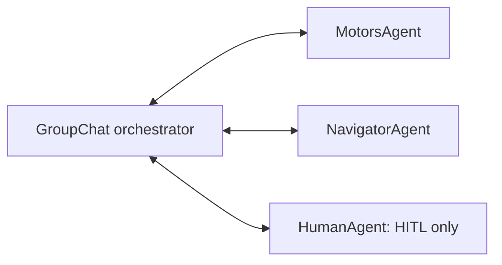
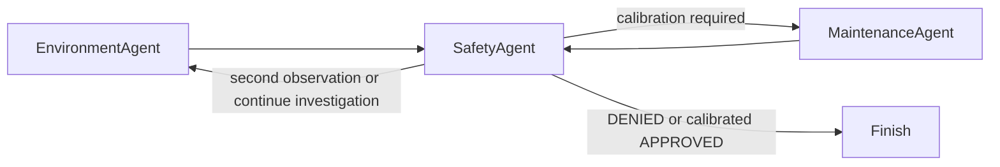

# Chapter 13 — Group chat orchestration (Python)

Python migrations of the three `13.GroupChat` code projects in `dcostea/AgentFrameworkBook`.
These run real Microsoft Agent Framework `GroupChatBuilder` workflows, not an agent-in-a-loop imitation.
All samples stop at **10 participant turns**, including human turns. No server is started.

## Run

From the repository root, using its existing virtual environment and provider configuration:

```powershell
.\.venv\Scripts\python.exe .\13.GroupChat\GroupChatOrchestration\main.py
.\.venv\Scripts\python.exe .\13.GroupChat\GroupChatOrchestrationWithCustomManager\main.py
.\.venv\Scripts\python.exe .\13.GroupChat\GroupChatOrchestrationWithHitl\main.py
```

Every script defaults to OpenAI and accepts `--provider azure`. Existing `shared.chat_clients` factories
load the root `.env`, select the model/deployment, and support Azure v1 and legacy API-version routing.
Use the same `OPENAI_API_KEY` / `OPENAI_CHAT_MODEL_ID`, or `AZURE_OPENAI_ENDPOINT`,
`AZURE_OPENAI_API_KEY`, and `AZURE_OPENAI_DEPLOYMENT_NAME` as the earlier chapters.
No extra configuration, ignore rules, or chapter-specific dependencies are needed beyond the parent's
`agent-framework-orchestrations==1.0.0rc3` pin (with core/OpenAI 1.8.1). This migration does not edit root files.
The SDK client closes on completion, errors, and cancellation. Native workflow streaming outputs and
executor completion events appear in the console; the final summary is taken from the designated actor,
not the orchestrator's synthesized completion message. Error event streams are drained and finalized
before raising, so the native workflow's cleanup hooks run (1.8.1 `ResponseStream` has no close method).

## Projects and source behavior

| Project | Participants and decisions | Terminal actor |
| --- | --- | --- |
| `GroupChatOrchestration` | Motors → Navigator, repeat; Navigator approves or supplies path/angle revisions | Motors |
| `GroupChatOrchestrationWithCustomManager` | Environment → Safety; manager conditionally selects another observation or Maintenance | Safety |
| `GroupChatOrchestrationWithHitl` | Motors → Navigator → Human, repeat; Navigator is advisory, Human is authoritative | Motors |

`ExecutionDecision` retains APPROVED / DENIED / EXECUTED; `SafetyDecision` retains
APPROVED / DENIED / CALIBRATION. Round-robin examples use real selection and termination callbacks.
`InvestigationManager` extends the framework's `GroupChatOrchestrator` (a `BaseGroupChatOrchestrator`),
using the native broadcasts, routing, participant responses, streaming, and round limits.

### Refined motor execution

The mission is to avoid a tree 50 meters ahead and return to the original path. Navigator prefers 30°, 45°,
or 60° turns, allowing 90° only when geometry requires it. Motors proposes without executing, revises
DENIED proposals, and executes only after Navigator approval. The Python adapter withholds the motor
tools and sets `tool_choice="none"` before approval (the provider adapter omits `tool_choice` on the wire
when there are no tools). Planning turns receive the real motor JSON schemas as **text-only reference**, plus a fresh instruction to
specify integer angle/distance arguments and incorporate the latest revision feedback. These schemas are
not executable tools or approval. Approved turns receive an explicit instruction to execute the reviewed
sequence and report EXECUTED only after tool completion. After an authoritative APPROVED, Motors can invoke
only the existing simulated `shared.tool_examples.create_motor_tools()` functions. No hardware is accessed. Repeated legitimate Navigator DENIED verdicts can still reach the cap; a
successful process exit or turn-limit stop is not evidence that Motors executed the mission. Approval and
completion are never synthesized to make a live model run appear successful.
Termination requires Motors' leading EXECUTED decision and the **most recent authoritative** approval,
or the turn cap. Unlike the C# substring predicate, a reason mentioning `APPROVED`, `NOT APPROVED`,
`UNEXECUTED`, or an old approval followed by a denial cannot falsely authorize/terminate execution.
The current turn's approval is consumed; a later proposal cannot reuse it without another review.

### Conditional investigation and calibration

Environment uses only the source temperature/humidity helpers relevant to its prompt: random integer
Celsius in `[-20, 99]`, humidity in `[0, 99]`, with 500 ms simulated latency. A temperature/humidity pair
successfully read using **both tools in the current Environment turn** is **one observation**. A repeated
text report, a missing/failed sensor result, or replayed call IDs cannot increment the count. Fresh identical
numeric readings can legitimately form a new observation when new tools actually ran.
`FreshSensorAgent` resets a `SensorTurnPolicy` chat middleware on each participant turn. The middleware
requires both tools initially, then only any missing tool, then removes them for the final report. Its
baseline excludes all previous session tool history; no ad hoc orchestration loop or synthetic readings
are added. The manager broadcasts the verified integer pairs for Safety to compare across observations.
Maintenance has only the 500 ms calibration tool,
whose success returns `All sensors have been calibrated.` Calibration does not change random readings.

1. Environment collects one observation; Safety reviews it.
2. First readings strictly above 90°C or 95% humidity are immediately DENIED.
3. Otherwise Safety requests CALIBRATION (nonterminal), and the manager obtains a second observation.
4. At two observations, Safety checks **both** against the normal limits: strictly above 60°C or 80% is DENIED.
5. Safe evidence without successful calibration requests CALIBRATION; the manager selects Maintenance.
6. After Maintenance, Safety returns a final verdict. APPROVED terminates only when calibration completed.

The common safe route is Environment → Safety → Environment → Safety → Maintenance → Safety.
Failed maintenance is followed by Safety, then another Maintenance attempt until success or the cap.
A calibrated but nonterminal Safety decision routes back to Environment to continue investigation.

The manager tracks integer observation count, actual last selected actor, iteration count, and calibration
state. It appends explicit user-role `InvestigationManager state` with verified sensor pairs to each broadcast.
Unverified reports are replaced with an explicit missing-evidence notice rather than misleading Safety.
APPROVED additionally requires at least two verified observations. It inspects raw
**current Maintenance turn** tool results before native text-only handoff removes them; successful
nonempty results without exceptions mark calibration complete, not a model's claim or an old sensor result.
Python 1.8.1 serializes a null tool result as empty text, which is not successful calibration evidence.
Only Safety's leading DENIED or calibrated APPROVED is terminal. Numeric comparisons remain the model's
responsibility, as in the source: this is a routing teaching example, **not production safety guidance**.

### Human intervention

`HumanAgent` implements the actual `SupportsAgentRun` protocol, including sessions and `ResponseStream`.
`HumanAgentExecutor` is a real workflow executor handling the native group-chat broadcast/request
messages, calling the injectable `read_input`, and returning a normally attributed HumanAgent response.
No Copilot `ask_user`, nested workflow, hidden approval, or automatic model approval is involved.

The console displays the proposed sequence and asks `HUMAN: Approve? [y/n, or feedback]`.
`y` / `yes` approves; `n` / `no`, empty input, and EOF deny. Other input is concrete denial feedback
(e.g. `Use 45 degrees and keep farther from the tree`). Motors revises and resubmits within the same
10-turn budget. A Navigator DENIED never overrides a human APPROVED; a Navigator APPROVED never
overrides a human DENIED. Motor tools are unavailable on denied branches.

## Python API adaptations

- rc3 returns a synthesized orchestrator `AgentResponse` (or streaming update), not C#'s final message-list
  output. The samples retain actor-attributed history and extract the designated last actor's text separately.
- Native text-only handoff avoids replaying unmatched provider tool-call envelopes between actors.
  Each Agent retains its own session; full broadcast context, latest-actor decisions, and raw calibration
  results are retained where needed.
- Tool-producing actors explicitly override `response_format` to `None`; optional typed
  `ExecutionVerdict` / `SafetyVerdict` output is available on the reviewing actors through the builders'
  `response_format` argument. Decision parsing accepts typed JSON and exact leading plain-text decisions.
- rc3 does not re-export the custom participant message/response envelopes and `ParticipantRegistry`.
  The shared implementation imports those installed framework definitions from
  `agent_framework_orchestrations._group_chat`; it does not recreate them.
- The source workflow diagrams are represented below without C#-specific generated executor IDs.
  No manuscript or book document was opened or copied.





## Offline regression tests

```powershell
.\.venv\Scripts\python.exe -m unittest discover -s tests -p test_group_chat.py -q
```

The 30 tests use real framework workflows and SDK provider adapters with offline mock transports or scripted
participants. They require no credentials, model service, external network, or hardware.

Official API references consulted:
[Group chat](https://learn.microsoft.com/en-us/agent-framework/workflows/orchestrations/group-chat?pivots=programming-language-python),
[Human-in-the-loop](https://learn.microsoft.com/en-us/agent-framework/workflows/human-in-the-loop?pivots=programming-language-python).
